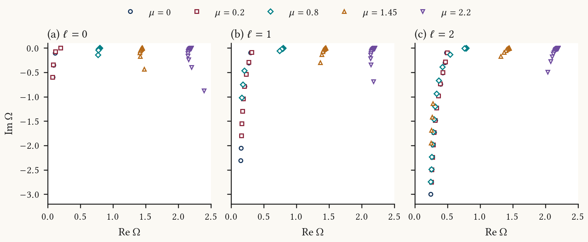

<!-- Author: Dr. Denys Dutykh (Mathematics Department, Khalifa University of Science and Technology, Abu Dhabi, UAE) -->

# massive-scalar: quasinormal modes of a massive scalar field around a Schwarzschild black hole



The complex roots Ω = Mω that pass the three-resolution test in the reports of `data/`, for the multipoles ℓ = 0, 1
and 2 and the masses μ = Mm = 0, 0.2, 0.8, 1.45 and 2.2 (roots within 10⁻³ of the real axis, which gather around
Ω ≈ μ and which the article attributes to the compactified spectral problem, are left out). For μ = 0 and μ = 0.2 the
roots follow the overtone branch of the Schwarzschild black hole, which a small mass hardly moves; for the larger
masses the least damped roots gather near Re Ω = μ, close to the real axis.

massive-scalar holds the routines and the raw spectra of the article by Davide Batic, Anna Chrysostomou, Alan S.
Cornell and Denys Dutykh in Physical Review D (2026), cited below. The quasinormal modes of a massive scalar field
around a Schwarzschild black hole are computed by an extended Chebyshev spectral method: the two-sheeted relation
between the frequency and the wave number at infinity is uniformised before the discretisation, which turns the radial
problem into a polynomial eigenvalue problem of degree seven. Maple assembles the matrices, MATLAB with the Advanpix
toolbox solves the problem in multiple precision, and two Python scripts check the results independently (a
continued-fraction benchmark and a check of the effective potential). The spectra of 47 cases (mass and multipole) are
stored at three resolutions, with their convergence reports.

## The problem

With the time dependence e^(−iωt), the radial equation of a scalar field of mass m around a Schwarzschild black hole of
mass M is

```text
f d/dr( f dψ/dr ) + ( ω² − V(r) ) ψ = 0,      f(r) = 1 − 2M/r,      V(r) = f(r) ( L/r² + 2M/r³ + m² ),      L = ℓ(ℓ+1),
```

and with x = r/(2M), Ω = Mω and μ = Mm the potential becomes

```text
M² V = (1 − 1/x) ( L/(4x²) + 1/(4x³) + μ² ),      x > 1.
```

At infinity the solution behaves like e^(±2ikx) with k² = Ω² − μ², so that k lies on one of two sheets. The Joukowski
map

```text
Λ = Ω + √(Ω² − μ²),      Ω = (Λ² + μ²) / (2Λ),      k = (Λ² − μ²) / (2Λ),
```

makes both Ω and k single-valued functions of Λ (the roots Λ and μ²/Λ give the same Ω and opposite k). Once the
behaviour at the horizon and at infinity is factored out, the remaining function is expanded in Chebyshev polynomials
and the equation is collocated at the Chebyshev–Gauss points, which gives the polynomial eigenvalue problem

```text
( M0 + i Λ M1 + Λ² M2 + i Λ³ M3 + Λ⁴ M4 + i Λ⁵ M5 + Λ⁶ M6 + i Λ⁷ M7 ) c = 0
```

for n × n matrices. It is solved at n = 180, 190 and 200 with as many decimal digits (180, 190 and 200), and a root is
kept when the three resolutions agree to 10⁻⁴ (criterion (20) of the article). Whether a root is a quasinormal mode, a
quasi-bound state or neither depends on its sheet, that is on k and not on the real part of Ω alone, as the article
explains; it also finds families of purely imaginary roots whose damping rates are spaced by about 1/4.

## Quick start

The computation runs in three stages, each from a working folder that holds the subfolders `assemble/` and `results/`.

First, in Maple, the assembler writes the eight matrices of one case (here μ = 0.7, ℓ = 1, n = 200 with 200 digits)
into `assemble/M0_200.mat` to `assemble/M7_200.mat` of the folder given as last argument:

```maple
read "maple/matrixassembler.mpl":
MatrixAssembler(200, 200, 0.7, 1, "/path/to/the/working/folder");
```

Its arguments are the number of digits d, the number of Chebyshev polynomials n, the mass μ, the multipole ℓ (the
routine forms ℓ(ℓ+1) itself) and the working folder. The call is repeated for n = 180 and 190 with d = n.

Second, in MATLAB with the Advanpix Multiprecision Computing Toolbox, `matlab/chaseeigs.m` reads the resolutions from
the file `resolutions.txt` of the working folder (here the three numbers 180, 190 and 200) and the mass μ from the
first line of `params.txt` (here 0.7), solves the problem at each resolution with `mp.Digits(n)` and writes the finite
roots Ω, real and imaginary parts in two columns, into `results/eigs_<n>.dat`. Each of the two MATLAB files adds the
toolbox from a fixed folder in its first lines, which must be changed to the folder of the local installation. The
second one, `matlab/03-chaseeigs_sheet_resolved.m`, does the same and also writes `results/eigs_sheet_resolved_<n>.dat`,
whose nine columns are Re Λ, Im Λ, Re Ω, Im Ω, Re k, Im k, |Λ| and two flags: the sheet (+1 when |Λ| > μ, −1 when
|Λ| < μ, 0 on the circle |Λ| = μ) and the behaviour at infinity (+1 for decay, Im k > 0, −1 for growth, 0 otherwise).
Since its name begins with a digit, MATLAB cannot call it by name: copy it to a valid name such as
`chaseeigs_sheet_resolved.m` first.

Third, the two Python scripts run in Python 3 with mpmath:

```bash
python3 python/04-massive_mode_benchmark.py
python3 python/05-potential_check.py
```

The first, which shares no code with the spectral method, solves the three-term recurrence of Konoplya and Zhidenko
(2005, cited below) by continued fractions with the Nollert tail, in 80-digit arithmetic, near the stored spectral
roots. It prints the comparison of twelve modes for μ = 0.1, 0.2, 0.7 and 0.8 (the spectral and continued-fraction
values differ by 3.2 × 10⁻¹⁸ to 2.7 × 10⁻¹⁵, except the slowly converging root of μ = 0.2, ℓ = 0, n = 0, where they
differ by 1.5 × 10⁻⁷), the convergence of that root with 1200 to 5000 terms, and a comparison with the Hill-determinant
values of reference [17] of the article (its Table V). It then writes the same report to a file whose folder is fixed
near the end of `main()` and must be changed to a local folder; otherwise the script stops there with an error, after
printing. The second script checks in 60-digit arithmetic the statements of the article on the potential for ℓ = 2
(L = 6) and μ = 0.7: the critical mass μ_c ≈ 0.740103 below which the potential has a local maximum followed by a
local minimum, the positions of these extrema as roots of 4μ²x³ − 2Lx² + 3(L − 1)x + 4, and the point
x_b = (5 + √43)/6, with μ_b² = −130/27 + 43√43/54 (μ_b ≈ 0.637847), where the local maximum reaches the value μ² of
the potential at infinity, below which it lies for μ_b < μ < μ_c.

## Contents

| Folder | What it holds |
|---|---|
| `maple/` | `matrixassembler.mpl`, the assembler, and the worksheet `02-Adapting to Spectral Method.mw`, which reduces the radial equation to the form the assembler uses |
| `matlab/` | `chaseeigs.m`, the multiple-precision solver, and `03-chaseeigs_sheet_resolved.m`, the same solver keeping Λ and k |
| `python/` | `04-massive_mode_benchmark.py`, the continued-fraction benchmark, and `05-potential_check.py`, the check of the potential |
| `mathematica/` | the notebook of Anna Chrysostomou that draws Figures 1 and 2 of the article (the potential for increasing μ, and the region of the (μ, L) plane where it has a local maximum followed by a local minimum) |
| `data/` | the spectra of 47 cases, one folder `mu_<μ>_L_<ℓ>` each |
| `pdf/` | the authors' version of the article (2 April 2026) |
| `docs/figures/` | the script that draws the figure of this page from the reports of `data/`, and the style file beside it |

The folder names of `data/` give the mass μ = Mm with an underscore for the decimal point (`mu_1_42_L_0` is μ = 1.42)
and, after `L_`, the multipole ℓ itself, not ℓ(ℓ+1): at μ = 0 the folders `L_1`, `L_2` and `L_10` hold the
Schwarzschild modes 0.292936 − 0.097660i, 0.483644 − 0.096759i and 2.021320 − 0.096256i of ℓ = 1, 2 and 10. The 47
cases cover μ = 0, 0.1, 0.2, 0.7, 0.8, 1.3, 1.4, 1.42, 1.45, 1.5, 2.2, 3, 10 and 100 with ℓ = 0, 1 and 2, and
μ = 0, 0.5, 1, 1.5 and 2 with ℓ = 10. Each folder holds, in `raw/`, the files `eigs_180.dat`, `eigs_190.dat` and
`eigs_200.dat` written by `chaseeigs.m` (every finite root Ω, real and imaginary parts in two columns, with as many
digits as the resolution), and a convergence report made by QNM Analyser from these files (tolerance 10⁻⁴; 43 reports
compare the three resolutions, and those of (μ, ℓ) = (0, 1), (0, 2) and (10, 2) compare n = 190 and 200, that of
(2.2, 2) n = 180 and 200). Each report lists the roots that agree, with Re Ω ⩾ 0, in three groups: complex roots,
roots on the real axis and roots on the imaginary axis. The nine-column files of the second solver are not stored.

QNM Analyser, the program that made the reports, reads three such files and finds the roots on which they agree; it
runs on a local computer from its repository:

https://github.com/dutykh/qnm-analyser

## Requirements

Maple, for the assembler; MATLAB with the Advanpix Multiprecision Computing Toolbox (a commercial toolbox), for the two
solvers; Python 3 with mpmath, for the two checks; Mathematica, for the notebook. The figure of this page is drawn from
`docs/figures/` by `python3 plot_readme_figure.py` (Python 3 with NumPy and Matplotlib).

## How to cite

If you use these routines or data, please cite the article:

D. Batic, A. Chrysostomou, A. S. Cornell and D. Dutykh, Quasinormal-mode analysis of a massive scalar field in a
Schwarzschild background via the spectral method, Physical Review D 114, 065020 (2026).

https://doi.org/10.1103/kv2k-1d3m

```bibtex
@article{Batic2026i,
  author = {Batic, Davide and Chrysostomou, Anna and Cornell, Alan S. and Dutykh, Denys},
  title = {Quasinormal-Mode Analysis of a Massive Scalar Field in a {{Schwarzschild}} Background via the Spectral Method},
  journal = {Physical Review D},
  year = 2026,
  month = sep,
  volume = {114},
  number = {6},
  pages = {065020},
  doi = {10.1103/kv2k-1d3m},
  eprint = {2609.37942},
  archiveprefix = {arXiv}
}
```

The button "Cite this repository" in the right-hand column of this page gives the same reference, read from
`CITATION.cff`. A free copy of the article is on arXiv:

https://arxiv.org/abs/2609.37942

The recurrence of the benchmark is that of

R. A. Konoplya and A. V. Zhidenko, Decay of massive scalar field in a Schwarzschild background, Physics Letters B 609,
377–384 (2005).

https://doi.org/10.1016/j.physletb.2005.01.078

The quasinormal-mode codes of this family are gathered in the QNMs Hall of Fame:

https://qnms.denys-dutykh.com/

## Licence

GNU Lesser General Public License, version 2.1 (see `LICENSE`).

## Authors

Davide Batic (Mathematics Department, Khalifa University of Science and Technology, Abu Dhabi), Anna Chrysostomou
(Laboratoire de Physique Théorique et Hautes Énergies, Sorbonne Université, CNRS, Paris), Alan S. Cornell (Department
of Physics, University of Johannesburg) and Denys Dutykh (Mathematics Department, Khalifa University of Science and
Technology, Abu Dhabi).

https://www.denys-dutykh.com/
